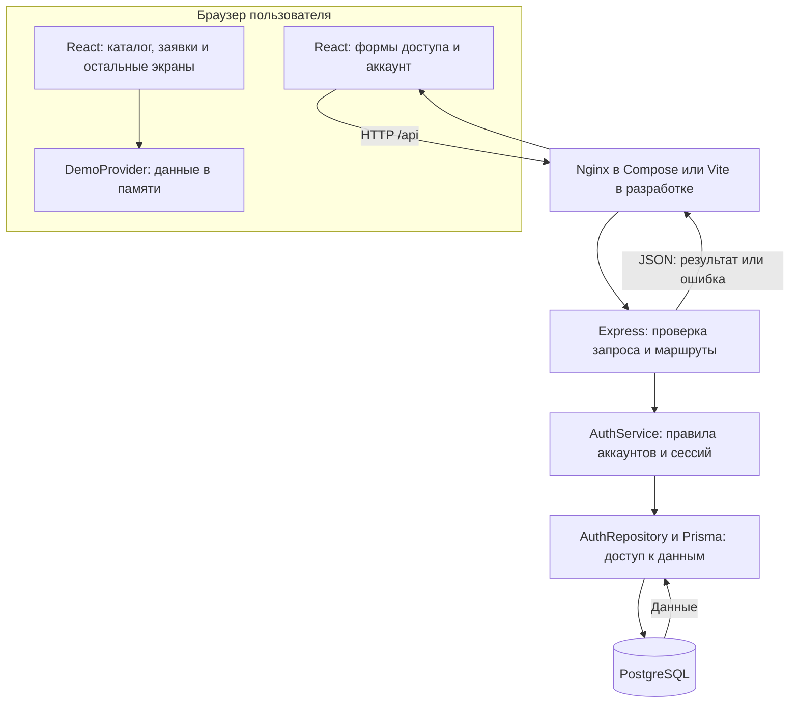
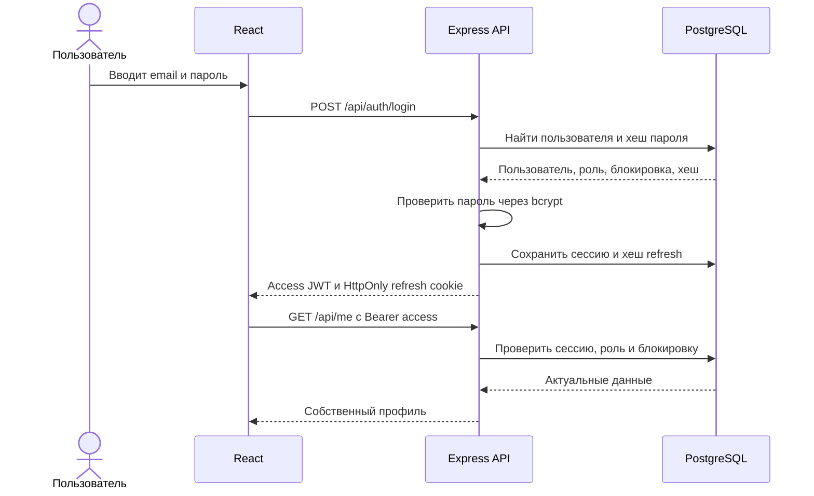
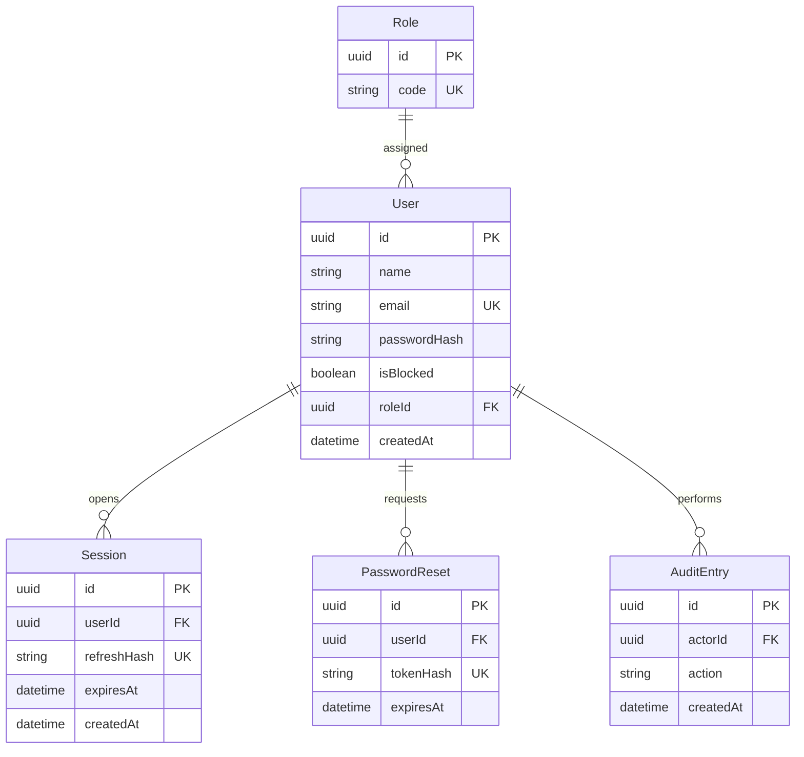

# Архитектура приложения

Состояние на 20.10.2026, реализация после [PR #19](https://github.com/Samirrrrr123/college-inventory/pull/19), коммит `3e44e41`. Документ описывает работающий модуль аккаунтов и существующий интерфейс. После интеграции предметного API схемы дополняются вместе с кодом.

## Компоненты и обмен данными

Интерфейс выполняется в браузере. Для аккаунтов он обращается к REST API; PostgreSQL напрямую браузеру недоступен. Контроллеры разбирают и проверяют входные данные, сервис отвечает за пароли и сессии, Prisma выполняет запросы к БД через репозиторий и операции чтения API.

У каталога, заявок, выдач и остальных шести основных разделов пока отдельное состояние в DemoProvider. Их операции не обращаются к PostgreSQL и пропадают после перезагрузки. Выбор демонстрационной роли не создаёт серверную сессию. Настройки темы и языка сохраняются в localStorage, токены и пароли туда не записываются.

## Общий запуск

| Компонент          | Compose                                         | Локальная разработка                |
| ------------------ | ----------------------------------------------- | ----------------------------------- |
| Интерфейс и прокси | Nginx, адрес `http://127.0.0.1:8080`            | Vite, адрес `http://127.0.0.1:5173` |
| API аккаунтов      | Сервис `backend`, порт 3001 внутри сети Compose | Порт 3001                           |
| PostgreSQL         | Сервис `db`, порт 5432 внутри сети Compose      | Адрес из `backend/.env`             |
| Постоянные данные  | Именованный volume `database`                   | Каталог локального PostgreSQL       |

Из браузера достаточно одного адреса: `/api` перенаправляется к backend. В Compose порт PostgreSQL на компьютер не публикуется. Сначала запускается и проходит проверку готовности база, затем backend применяет миграции и seed, после него запускается frontend. Повторный seed сохраняет существующие пароли.

`compose.yaml` сейчас предназначен для локального запуска. Публичный сервер ещё не выбран и приложение не опубликовано. Для публикации потребуется настроить HTTPS, точный `CLIENT_ORIGIN`, production-переменные и доступ к приложению извне.

## Вход и проверка доступа

- Access JWT действует 15 минут и хранится только в памяти frontend.
- Refresh JWT действует 7 дней и передаётся в HttpOnly cookie. В БД хранится его SHA-256, не исходный токен.
- При обновлении сессии refresh заменяется. Одновременные попытки использовать один refresh не создают две действующие замены.
- После перезагрузки страницы frontend восстанавливает access через refresh cookie. Для параллельных запросов используется одно обновление сессии.
- Выход удаляет текущую сессию. Смена или восстановление пароля отзывает все сессии пользователя.
- Каждый защищённый запрос проверяет актуальную роль и блокировку по БД. Регистрация назначает только роль преподавателя.

Cookie имеет `SameSite=Lax`, ограниченный путь `/api/auth` и флаг `Secure` в production. Изменяющие запросы требуют Origin, совпадающий с `CLIENT_ORIGIN`. Восстановление использует одноразовый код на 30 минут; ссылка выводится в журнал сервера, как разрешено заданием.

## Текущая схема БД аккаунтов

Схема сверена с `backend/prisma/schema.prisma` и миграцией `202610200001_auth`. Роли: `teacher`, `technician`, `admin`. Связи показаны как один ко многим; PK обозначает первичный ключ, FK - внешний, UK - уникальное поле. Пароли хранятся как bcrypt-хеши с cost 12. Удаление пользователя каскадно удаляет его сессии и коды восстановления; история действий связана отдельным внешним ключом.

Сейчас реализовано 5 таблиц аккаунтов. Требование команды о минимум 8 таблицах и связи многие ко многим ещё предстоит закрыть предметной схемой оборудования. Её проектирует Артём и добавляет отдельными миграциями. Существующая схема аккаунтов не является итоговой ER-диаграммой всего MVP.

## Проверки и продолжение интеграции

GitHub Actions проверяет линтер, формат, типы, тесты, сборки и общий Compose. Подробные результаты и границы проверки приведены в [отчёте о тестировании](testing-report.md).

Следующий блок интеграции - API оборудования, категорий и аудиторий от Артёма с миграциями и OpenAPI. После его готовности Самир подключает к серверным спискам и операциям соответствующие экраны. Далее таким же образом подключаются заявки, выдачи и остальные разделы.
