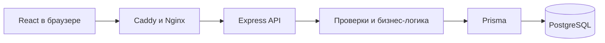

# Устройство приложения

## Как всё работает

- React показывает страницы и отправляет запросы к `/api`.
- Контроллеры принимают запросы, сервисы проверяют правила, репозитории работают с БД.
- Prisma описывает таблицы. Изменения применяются миграциями, seed добавляет тестовые данные.
- Docker Compose запускает приложение одной командой. На VPS Caddy добавляет HTTPS.
- API и база доступны через внутреннюю сеть Docker.

## Вход и роли

Пароли хранятся в виде bcrypt-хешей. После входа выдаются access JWT на 15 минут и refresh JWT на 7 дней. Access остаётся в памяти браузера, refresh — в HttpOnly cookie. Выход и смена пароля отзывают сессии.

Сервер проверяет роль и блокировку при каждом защищённом запросе. Преподаватель читает каталог и работает со своими заявками. Лаборант и администратор ведут каталог, рассматривают заявки и оформляют выдачи.

## Основные правила

- В заявке 1–20 предметов. Одобрение не резервирует технику.
- Выдача и возврат сохраняются целиком: ошибка по одному предмету отменяет всю операцию.
- Повторно выдать занятую технику или принять тот же возврат нельзя.
- Фото и PDF до 5 МБ хранятся в БД. Сервер проверяет тип, размер и права; скачивание требует входа.
- Инвентаризация фиксирует состав аудитории при начале. Все предметы нужно отметить; после завершения ответы не меняются. Сама проверка не меняет статусы или расположение техники.
- Все данные рабочих страниц постоянные. Отдельная демоверсия хранит изменения только до перезагрузки.
- Темы и язык сохраняются в браузере, пароли и токены туда не записываются.
- Только администратор меняет роли и блокировку пользователей. При изменении доступа старые сессии закрываются. Последний активный администратор защищён, в том числе от одновременных изменений.

## Схема БД

В БД 16 таблиц. PK — первичный ключ, FK — внешний ключ, UK — уникальное поле. RequestItem и LoanItem связывают заявки и выдачи с несколькими предметами. InventoryItem хранит сведения о предмете на момент проверки. Исторические записи защищены от случайного удаления внешними ключами.

## Запуск и API

Адреса и команды находятся в [README](../README.md), методы API — в [Swagger](https://85.8.201.148/api/docs/). Проверки описаны в [отчёте](testing-report.md).

Модуль backend/src/history читает существующие Movement и AuditEntry без создания второго источника истории. GET /api/movements доступен technician/admin, GET /api/audit — только admin. Фильтры, порядок и пагинация выполняются на сервере; страница и total читаются в одном repeatable-read снимке. Четыре новых индекса поддерживают чтение истории. Интерфейсы /app/movements и /app/audit используют существующий API-клиент, сессии и компоненты. Подробнее — в [передаче](history-handoff.md). Статистика и XLSX остаются отдельными блоками.
