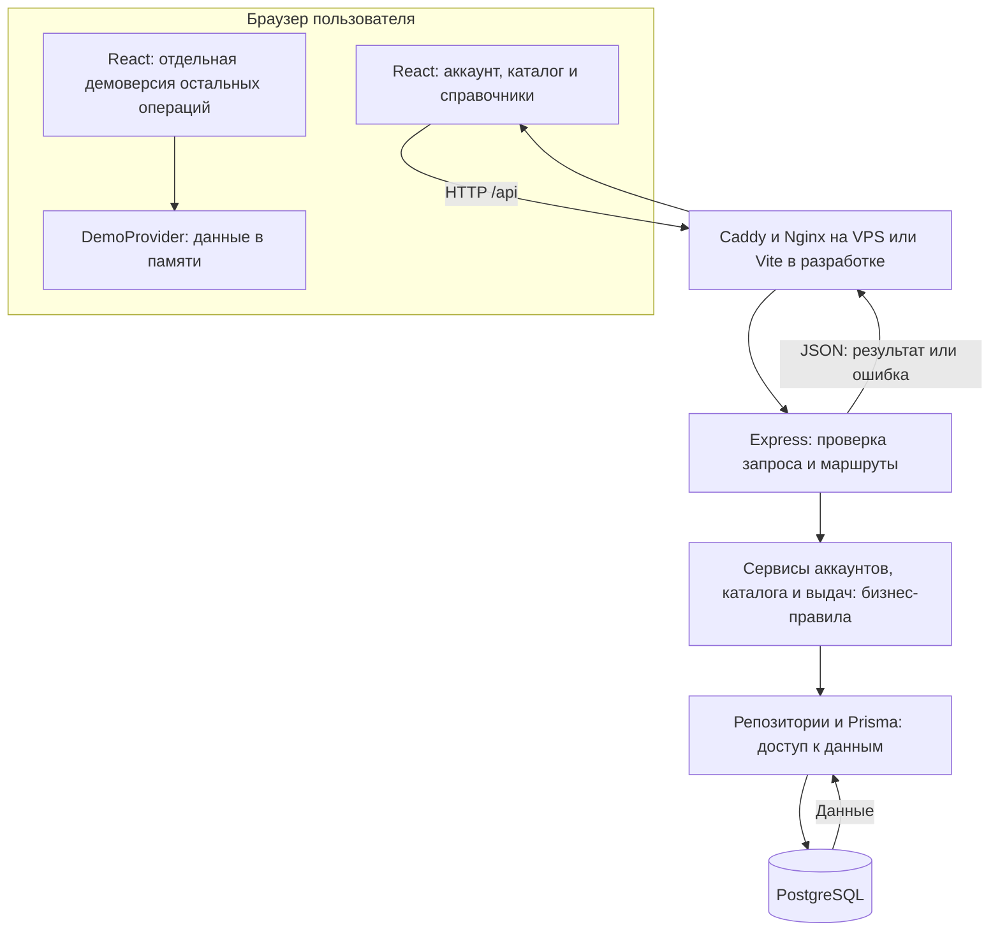
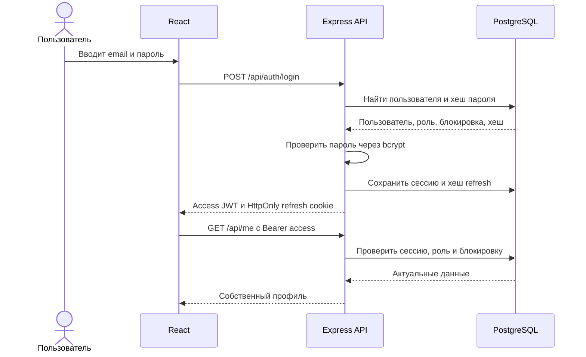
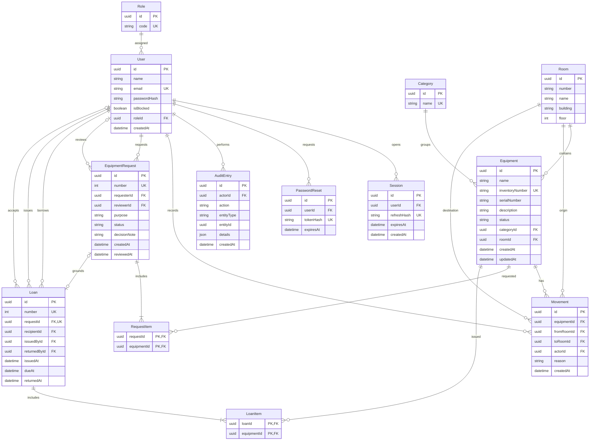

# Архитектура приложения

Состояние на 21.10.2026: аккаунты, каталог, заявки, выдачи и возвраты с подключёнными экранами; публикация на VPS через Docker Compose. Схемы описывают реализованную часть; инвентаризация, файлы и статистика ещё предстоят.

## Компоненты и обмен данными

Интерфейс выполняется в браузере. Рабочие разделы обращаются к REST API; PostgreSQL напрямую браузеру недоступен. Контроллеры проверяют запросы, сервисы выполняют бизнес-правила, репозитории используют Prisma для доступа к БД. Смена аудитории сохраняет оборудование, перемещение и аудит в одной транзакции.

Рабочие маршруты `/app/equipment`, `/app/requests`, `/app/rooms`, `/app/categories` и `/account` используют серверную сессию и постоянные данные. Отдельная демоверсия сохраняет прежние шесть экранов в DemoProvider; её операции пропадают после перезагрузки. Выбор демонстрационной роли не создаёт серверную сессию. Настройки темы и языка сохраняются в localStorage, токены и пароли туда не записываются.

Заявка содержит от 1 до 20 конкретных единиц и не резервирует технику. Одобрение меняет только заявку. При выдаче Serializable-транзакция проверяет автора заявки, решение, отсутствие предыдущей выдачи и активность получателя, затем переводит весь доступный комплект в статус issued и сохраняет выдачу с аудитом. Недоступность хотя бы одного предмета откатывает все изменения. Возврат одной транзакцией закрывает выдачу, освобождает весь комплект и добавляет аудит. Конфликты сериализации ограниченно повторяются; повторная выдача и повторный возврат запрещены. Преподаватель получает только свои заявки и выдачи; подстановка чужого ID возвращает 404.

## Общий запуск

| Компонент          | Compose                                         | Локальная разработка                |
| ------------------ | ----------------------------------------------- | ----------------------------------- |
| Интерфейс и прокси | Nginx, адрес `http://127.0.0.1:8080`            | Vite, адрес `http://127.0.0.1:5173` |
| REST API           | Сервис `backend`, порт 3001 внутри сети Compose | Порт 3001                           |
| PostgreSQL         | Сервис `db`, порт 5432 внутри сети Compose      | Адрес из `backend/.env`             |
| Постоянные данные  | Именованный volume `database`                   | Каталог локального PostgreSQL       |

Из браузера достаточно одного адреса: `/api` перенаправляется к backend. В Compose порт PostgreSQL на компьютер не публикуется. Сначала запускается и проходит проверку готовности база, затем backend применяет миграции и seed, после него запускается frontend. Повторный seed сохраняет существующие пароли.

На VPS Ubuntu 24.04 приложение опубликовано по `https://85.8.201.148/login`. Production-переопределение `compose.production.yaml` добавляет Caddy, `NODE_ENV=production` и точный HTTPS-origin. Caddy получает и автоматически продлевает сертификат Let’s Encrypt для IPv4; сертификаты и БД хранятся в отдельных volumes. HTTP перенаправляется на HTTPS. Публичны порты сайта 80/443 и SSH; backend и БД доступны только внутри сети Docker.

Express доверяет только заданному числу прокси: `TRUST_PROXY_HOPS=2` на VPS, 1 в локальном Compose и 0 при прямом запуске. Это позволяет ограничивать попытки входа отдельно для посетителей. Дополнительные адреса слева в заголовке не меняют определяемого клиента. SSH проверен по отдельному ключу, вход по паролю отключён.

## Вход и проверка доступа

- Access JWT действует 15 минут и хранится только в памяти frontend.
- Refresh JWT действует 7 дней и передаётся в HttpOnly cookie. В БД хранится его SHA-256, не исходный токен.
- При обновлении сессии refresh заменяется. Одновременные попытки использовать один refresh не создают две действующие замены.
- После перезагрузки страницы frontend восстанавливает access через refresh cookie. Для параллельных запросов используется одно обновление сессии.
- Выход удаляет текущую сессию. Смена или восстановление пароля отзывает все сессии пользователя.
- Каждый защищённый запрос проверяет актуальную роль и блокировку по БД. Регистрация назначает только роль преподавателя.

Cookie имеет `SameSite=Lax`, ограниченный путь `/api/auth` и флаг `Secure` в production. Изменяющие запросы требуют Origin, совпадающий с `CLIENT_ORIGIN`. Восстановление использует одноразовый код на 30 минут; ссылка выводится в журнал сервера, как разрешено заданием.

## Текущая схема БД

Схема сверена с `backend/prisma/schema.prisma` и четырьмя миграциями. Роли: `teacher`, `technician`, `admin`. PK обозначает первичный ключ, FK - внешний, UK - уникальное поле. Для аудитории уникальна пара `building, number`; составные ключи RequestItem и LoanItem запрещают повтор предмета в комплекте. Пароли хранятся как bcrypt-хеши с cost 12. Удаление пользователя каскадно удаляет его сессии и коды восстановления; история действий, заявок и выдач защищена внешними ключами.

Сейчас реализовано 13 таблиц. Связи многие ко многим реализованы через RequestItem и LoanItem; количественный минимум команды и типы связей выполнены. Это ещё не означает готовность всего MVP. Nullable-поля и все индексы перечислены в Prisma-схеме; ER-диаграмма показывает основные поля и связи.

## Проверки и продолжение интеграции

GitHub Actions проверяет линтер, формат, типы, тесты, сборки и общий Compose. Подробные результаты и границы проверки приведены в [отчёте о тестировании](testing-report.md).

Каталог, заявки, выдачи, возвраты и справочники подключены к серверным спискам. Проверенные изменения обновляются на VPS без удаления volumes. Артём продолжает загрузки, инвентаризацию, управление пользователями, статистику и экспорт; существующие модули аккаунтов и выдач используются без дублирования.
