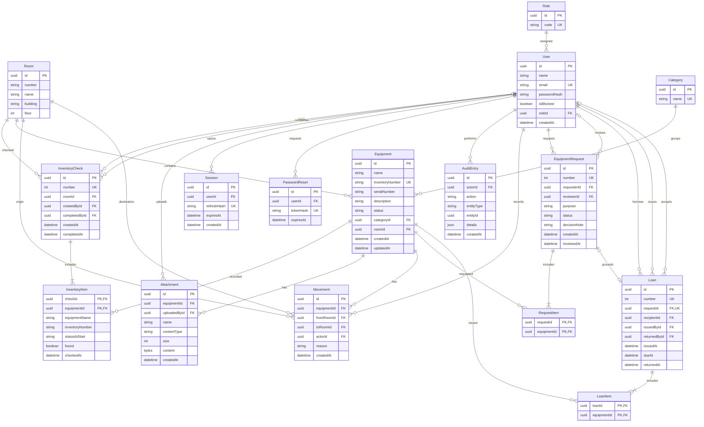

# Устройство приложения

React показывает страницы и отправляет запросы в Express API. Контроллер принимает запрос, сервис проверяет правила, репозиторий обращается к PostgreSQL через Prisma. Caddy и Nginx передают запросы на VPS.

## Основные правила

- Пароли защищены bcrypt. Access JWT хранится в памяти страницы, refresh JWT в HttpOnly cookie. Выход и смена пароля закрывают сеансы.
- Сервер проверяет роль и владельца записи. Преподаватель видит только свои заявки и выдачи. Каталог оборудования общий.
- В заявке от 1 до 20 разных предметов. Доступность проверяется при выдаче. Комплект выдаётся и возвращается целиком.
- Файлы PNG, JPG и PDF до 5 МБ хранятся в БД. Проверяются размер, тип и права.
- Инвентаризация сохраняет состав аудитории. Завершённый результат нельзя изменить.
- Перемещения доступны сотрудникам, журнал аудита только администратору. Поиск и страницы обрабатывает сервер.
- Последнего активного администратора нельзя отключить. Смена роли и блокировка закрывают сеансы.
- XLSX использует фильтры каталога, до 5000 строк. Пользовательский текст не превращается в формулы.

## Схема БД

16 таблиц. PK означает первичный ключ, FK внешний ключ, UK уникальное поле. RequestItem и LoanItem связывают заявки и выдачи с несколькими предметами. Изменения применяются миграциями, seed добавляет тестовые данные.

[API в Swagger](https://85.8.201.148/api/docs/) · [Запуск](../README.md) · [Проверки](testing-report.md)
